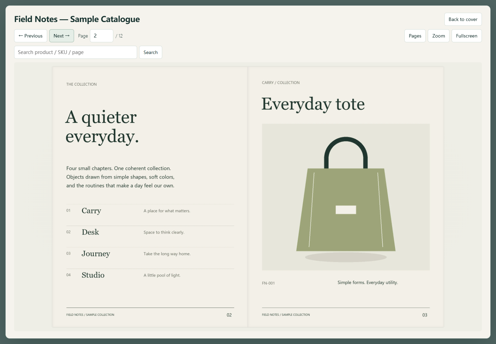

# WordPress PDF Catalogue Flipbook Builder

[中文说明](README.zh-CN.md) · [Skill instructions](SKILL.md) · [Publishing](PUBLISHING.md) · [Testing](TESTING.md)

Turn a finished product catalogue PDF or ordered page images into a **WordPress
plugin ZIP**, with a cover-first page-turning reader. Built for catalogue delivery,
not photo styling. WordPress integration is part of the output, not a deployment
step left for the user to solve.

**Project name:** WordPress PDF Catalogue Flipbook Builder.  
**Skill and GitHub repository:** `build-wordpress-pdf-catalogue-flipbook`.  
**Chinese name:** WordPress PDF 产品目录翻页插件生成器.

The name describes the whole workflow: catalogue PDF/page images → book-like
reader → installable WordPress plugin with a Gutenberg block and shortcode.
Generated plugins are named **WordPress PDF Catalogue Flipbook** by default.
They remain readers; PDF conversion runs on the build machine, not in WordPress.



Desktop screenshot of the included fictional demo. [Mobile view](examples/preview-mobile.png).

## What makes this project different

- An independent plugin: Gutenberg block, shortcode, settings reference and local
  assets. No theme editing, iframe, CDN or Node.js on the WordPress host.
- Preserve finished artwork: no forced crop or stretched product proportions;
  separate display, high-resolution and thumbnail images; no raster upscaling.
- Cover → reader → cover, desktop spreads and mobile single pages; page turns,
  thumbnails, jump, search, zoom with individual page selection, and fullscreen.
- WordPress-aware delivery: escaped output, validated catalogue paths, multiple
  instances, late-render asset handling, versioned URLs and recoverable failures.
- A reproducible builder, package validator, regression tests, neutral example,
  documentation, licenses and GitHub Actions workflow.

This is independently written, not an official release or renamed copy of
`create-photo-flipbook-ui`. StPageFlip is a separately licensed dependency; see
[third-party notices](THIRD_PARTY_NOTICES.md).

## Two packages, two destinations

| Package | Use |
| --- | --- |
| This repository / source ZIP | Install as a Codex Skill or publish on GitHub. **Not** a WordPress plugin ZIP. |
| Generated `wp-product-flipbook.zip` | Upload to **WordPress → Plugins → Add New → Upload Plugin**. Includes viewer code and catalogue pages. |

Keep your private input PDFs and generated company plugins outside the public
repository. Only fictional, generated sample content belongs in this repository.

## Use as a Skill

Place this repository's directory, with `SKILL.md` directly inside it, in your
configured Codex skills directory, named `build-wordpress-pdf-catalogue-flipbook`.
Reload the skill list or start a new session. Then ask:

> Use $build-wordpress-pdf-catalogue-flipbook to turn this catalogue PDF into a
> WordPress plugin. Keep the original page proportions and small text legible.
> Add a cover-first reader and give me a tested installable ZIP.

The skill uses a local Python build. It does not install plugins on a live site,
publish a GitHub repository, or upload your PDF without being asked.

## Build without an agent

Build machine: Python **3.10+** (3.12 recommended). WordPress host: PHP **7.4+**
and WordPress **6.2+** are the template's minimum targets; see [tested coverage](TESTING.md).
Use a current browser with native dialog, ResizeObserver and WebP support.

```bash
python -m pip install -r requirements.txt
python scripts/build_wordpress_flipbook.py --input "/path/to/catalogue.pdf" --output "/path/to/new-build" --catalogue-title "Product Catalogue"
python scripts/validate_wordpress_package.py /path/to/new-build/wp-product-flipbook.zip
```

An image directory can be passed to `--input` instead of a PDF. Output includes
the unpacked plugin, ZIP, SHA-256 and build report. Existing matching artifacts
are never overwritten; use a new output directory for each build.

### Try the fictional demo

```bash
python scripts/generate_demo_pages.py --output dist/demo-input
python scripts/build_wordpress_flipbook.py --input dist/demo-input/pages --metadata dist/demo-input/metadata.json --output dist/demo --catalogue-title "Field Notes — Sample Collection"
python scripts/validate_wordpress_package.py dist/demo/wp-product-flipbook.zip
```

After installing and activating the generated ZIP, add the **Product Flipbook**
block to a page, or insert a **Shortcode** block containing:

```text
[product_flipbook catalogue="default"]
```

For a reader inside the page instead of a modal:

```text
[product_flipbook catalogue="default" mode="inline"]
```

Publish the page and add it to your site's navigation using WordPress. The plugin
does not create menus or pages automatically. A shortcode will render on the
frontend; the editor's Shortcode block itself is not a live viewer.

## Quality and content

Defaults: 1600 px display / 2400 px high-resolution long edge, 320 px thumbnails,
WebP quality 88. Increase resolution for fine type after inspecting the source.
Source PDF download is opt-in with `--include-pdf`.

The builder treats each PDF page as **one book leaf**. Already-designed two-page
spreads require deliberate splitting before building; print imposition cannot be
reordered safely by guessing. Mixed page sizes are padded; odd counts get a
neutral back cover unless `--no-pad-even` is set. See [conversion and metadata](references/conversion.md).

PDF text and supplied SKU metadata support reader search. There is no OCR.
Hotspots can link pages to products; add normal product descriptions and links
outside the reader for accessibility and search engines.

## Boundaries

- One generated plugin bundle active per site. Multiple instances are supported;
  multiple catalogues can be assembled into the same bundle. Do not install
  independently generated copies side by side. See [WordPress details](references/wordpress.md).
- No WordPress PDF uploader/converter, online catalogue editor, WooCommerce sync,
  login gate, analytics, email form or automatic navigation mutation.
- All bundled catalogue files are public assets. This is not a private-document
  distribution system. Page-image fallbacks are available without JavaScript;
  an image-only PDF is not an accessible text document.
- Cache/minification/CDN combinations and commercial page builders require
  verification on the target site. No blanket compatibility guarantee.

## Development and release

Version 1.0.1 gives the project its more specific name. The generated plugin folder
`wp-product-flipbook`, main PHP filename, `product_flipbook` shortcode and
`wpcf/product-flipbook` block identifier are unchanged, so the naming change does
not require replacing page content or installing a second plugin.

See [TESTING.md](TESTING.md), [CONTRIBUTING.md](CONTRIBUTING.md),
[PUBLISHING.md](PUBLISHING.md) and [CHANGELOG.md](CHANGELOG.md).
Original code: MIT. Catalogue owners retain their artwork rights.
